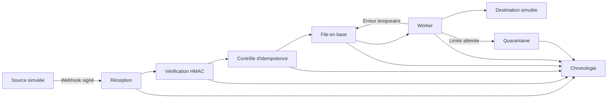

# Architecture cible de SyncOps

## Vue d'ensemble

## Composants

### Application web

Le service Laravel reçoit les requêtes, valide les entrées, expose l'interface publique et enregistre les événements. Il ne réalise pas le traitement long pendant la requête HTTP.

### Worker

Un processus distinct consomme la file Laravel. Il applique une politique de reprises bornée, enregistre chaque tentative et classe un échec définitif en quarantaine.

### Planificateur

Un job App Platform réinitialise les données fictives chaque jour à 04:00, heure de Paris. Le reset verrouille les tables sur PostgreSQL et refuse toute base contenant un compte ou un connecteur hors du périmètre de démonstration.

### PostgreSQL

La base conserve les événements, les tentatives, la chronologie et la file. Les clés d'unicité garantissent l'idempotence même en présence de requêtes concurrentes.

## Frontières de confiance

- toute charge utile entrante est non fiable ;
- le secret HMAC reste côté serveur ;
- les données affichées sont échappées et les champs sensibles masqués ;
- les destinations du MVP sont locales et prédéfinies ;
- aucune adresse réseau reçue d'un visiteur n'est utilisée par le worker.

## Observabilité

Chaque événement possède un identifiant de corrélation. Les journaux structurés, les tentatives et la chronologie utilisent cet identifiant afin de reconstituer le parcours sans exposer la charge utile complète.

Les indicateurs initiaux seront le volume reçu, le taux de succès, le nombre de doublons, les reprises planifiées, la durée de traitement et la taille de la quarantaine.

## Déploiement DigitalOcean

Le fichier `.do/app.yaml` définit quatre composants App Platform : service web, worker, job de préparation avant déploiement et job planifié. PostgreSQL 18 est attaché via `${syncops-db.DATABASE_PRIVATE_URL}`. L'auto-déploiement reste désactivé afin qu'une fusion GitHub ne déclenche pas automatiquement une mise en production.

Le VPC `default-lon1` est sélectionné manuellement pour garder son UUID hors du dépôt et placer l'application et la base dans le même réseau privé. Les quatre secrets de runtime restent eux aussi hors App Spec : la clé Laravel et les trois secrets HMAC sont ajoutés uniquement au composant web.

Le socle minimal revient à 17 USD/mois : 5 USD pour le web, 5 USD pour le worker et 7 USD pour la base de développement, auxquels s'ajoute le temps d'exécution des deux jobs. Le dépôt ne crée lui-même aucune ressource et n'engage aucun coût tant que le spec n'est pas importé.

### Procédure contrôlée

1. importer `.do/app.yaml` depuis la branche `main` et laisser l'auto-déploiement désactivé ;
2. sélectionner manuellement le VPC `default-lon1` pour les quatre composants et la base ;
3. ajouter au seul composant web les quatre secrets chiffrés avec portée d'exécution ;
4. vérifier le coût, le domaine `syncops.mkirchel.com`, PostgreSQL 18 et les quatre composants avant de créer l'application ;
5. dans Cloudflare, ajouter le CNAME `syncops` vers le domaine de démarrage DigitalOcean en mode DNS only ;
6. attendre que le domaine soit actif, puis vérifier HTTPS, `/health`, le tableau de bord et le traitement par le worker ;
7. conserver la redirection HTTPS 301 limitée à `syncops-znptj.ondigitalocean.app`, sans URI de destination, afin de préserver le chemin et la chaîne de requête.

Le job de préparation valide la configuration, applique les migrations, restaure la démonstration et revérifie les compteurs. Le web et le worker refusent de démarrer si la configuration ou les données attendues sont incomplètes. Les erreurs ne réimpriment jamais l'URL privée de connexion.
