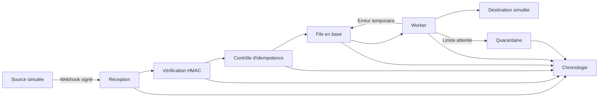

# Architecture cible de SyncOps

## Vue d'ensemble

## Composants prévus

### Application web

Le service Laravel reçoit les requêtes, valide les entrées, expose l'interface publique et enregistre les événements. Il ne réalise pas le traitement long pendant la requête HTTP.

### Worker

Un processus distinct consomme la file Laravel. Il applique une politique de reprises bornée, enregistre chaque tentative et classe un échec définitif en quarantaine.

### Planificateur

Le planificateur entretient les données fictives et pourra réinitialiser périodiquement la démonstration. Toute tâche planifiée devra empêcher les exécutions concurrentes.

### PostgreSQL

La base conserve les événements, les tentatives, la chronologie et la file. Les clés d'unicité garantissent l'idempotence même en présence de requêtes concurrentes.

## Frontières de confiance

- toute charge utile entrante est non fiable ;
- le secret HMAC reste côté serveur ;
- les données affichées sont échappées et les champs sensibles masqués ;
- les destinations du MVP sont locales et prédéfinies ;
- aucune adresse réseau reçue d'un visiteur n'est utilisée par le worker.

## Observabilité

Chaque événement possède un identifiant de corrélation. Les journaux structurés, les tentatives et la chronologie utilisent cet identifiant afin de reconstituer le parcours sans exposer la charge utile complète.

Les indicateurs initiaux seront le volume reçu, le taux de succès, le nombre de doublons, les reprises planifiées, la durée de traitement et la taille de la quarantaine.

## Déploiement envisagé

La cible sera DigitalOcean App Platform avec trois processus distincts : service web, worker et job planifié. PostgreSQL 18 sera attaché par URL privée. L'auto-déploiement restera désactivé afin qu'une fusion GitHub ne déclenche pas automatiquement une mise en production.

Ce dépôt ne crée encore aucune ressource cloud et n'engage aucun coût.
